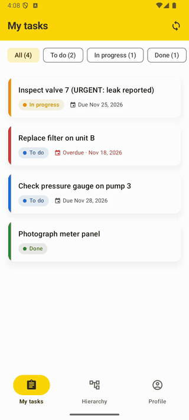
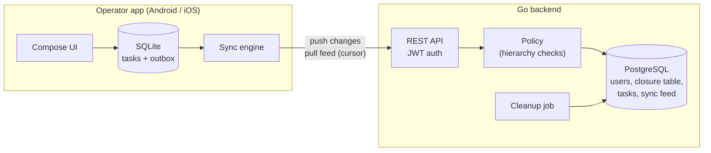

# EdgeAware

**Offline-first task management for field teams.** Managers assign work down a
multi-level org chart; field operators get it on their phones, update it with no
signal, and everything syncs when they're back online without losing anyone's edits.


<p align="center">
  
</p>

## What it does

- **Org hierarchy of any depth:** director → managers → supervisors → operators.
  Seniors see and manage everyone below them; nobody sees above themselves or into
  another branch.
- **Task assignment** down that hierarchy, with due dates, statuses and overdue tracking.
- **Works offline:** the mobile app saves every change on the phone first and syncs it
  later. Conflicting edits from a supervisor and an operator are both kept.
- **Android and iOS** from one Kotlin codebase with a shared Compose UI.

## Engineering highlights

| Problem | Solution |
|---|---|
| "Can this user see that one?" at any depth, fast | **Closure table** (`user_hierarchy`) storing every senior–junior pair, so permission checks are one indexed lookup instead of a recursive walk up the tree. Moving a manager moves their whole team in one transaction. |
| Two people edit the same task, one of them offline | **Optimistic locking** with a per-task `version`. The server returns `409` with its copy. The app rebases the operator's status change onto the newer version and retries, so both edits survive. |
| Phones need only *their* changes since last sync | **Per-user change feed** with fan-out: each task change is written once for the assignee and every senior above them, numbered from one global sequence. Devices pull with a cursor. |
| Feed entries committing out of order would make devices skip changes | Feed writes take a **Postgres advisory lock**, so sequence numbers become visible strictly in order. Covered by a concurrency test with parallel writers and pullers. |
| Flaky networks make clients retry uploads | **Idempotent push:** each change carries an `op_id`, and results are stored per device. Re-sending a batch returns the original results and changes nothing. |
| Reassigned tasks must disappear from the old assignee's phone | `revoked` feed entries when a task is reassigned or a team moves. |
| The feed can't grow forever | **Cleanup job** deletes entries every device has pulled (or after 30 days), behind an advisory lock so only one instance runs it. Devices with an expired cursor get `410 Gone` and download a fresh **snapshot**. |
| Field app must be usable with no signal | **Offline-first mobile:** SQLite (SQLDelight) is the source of truth for the UI. An outbox queues changes and collapses repeat edits to the same task. Sync runs on launch, every 30 s, and after each change. Expired sessions keep queued work until the user logs back in. |

## Architecture



## Tech stack

| | |
|---|---|
| **Backend** | Go (standard-library router), GORM, PostgreSQL, JWT, bcrypt |
| **Mobile** | Kotlin Multiplatform, Compose Multiplatform, Ktor client, SQLDelight, kotlinx.serialization, coroutines and Flow |
| **Testing** | Go integration tests against a real Postgres, including concurrency; Kotlin sync-engine tests with a fake server and in-memory SQLite |
| **Tooling** | Docker Compose for Postgres, Gradle |

## Project structure

```
cmd/            api server, database seeder, standalone cleanup job
internal/
  hierarchy/    closure-table queries (add, move, is-under, team)
  policy/       who can see / edit whom (single place for access rules)
  task/ user/   REST handlers and services
  sync/ feed/   offline sync: push, pull, snapshot, change feed fan-out
  cleanup/      feed and push-result retention
  server/       router + integration tests
mobile/         Kotlin Multiplatform app (see mobile/README.md)
docs/           backend design and full API reference
```

## Run it

**Backend** (needs Go and Docker):

```bash
docker compose up -d
go run ./cmd/seed
JWT_SECRET=change-me go run ./cmd/api
```

The seeder creates a sample 4-level org. The usernames and the development password are
in [internal/seed/seed.go](internal/seed/seed.go).

**Android app:** with the backend running, open `mobile/` in Android Studio and run
`composeApp` on an emulator, or run `./gradlew :composeApp:installDebug` from `mobile/`.
Log in as `operator_n1a`. More in [mobile/README.md](mobile/README.md).

## Tests

```bash
# Backend: 12 integration test groups (auth, hierarchy visibility, permissions,
# user moves, sync pull/push, concurrency, cleanup). They drop all tables in the
# database you point them at, so use a dedicated test database.
TEST_DATABASE_URL="host=localhost user=postgres password=postgres dbname=edgeaware_test sslmode=disable" go test ./...

# Mobile: 10 sync-engine tests (offline queueing, conflicts, revokes, expired cursor)
cd mobile && ./gradlew :composeApp:testDebugUnitTest
```

## Documentation

- [Backend design and API reference](docs/backend.md): data model, access rules, every
  endpoint, the sync protocol, cleanup, and configuration.
- [Mobile app](mobile/README.md): features, offline behavior, and how to run it on
  Android and iOS.

## Status and next steps

The backend and the Android app work end to end. Next steps:

- **iOS:** the shared code and the iOS entry point are written, but the app hasn't been built yet (needs Xcode).
- **Manager web dashboard** for creating and assigning tasks. Today that's done through the API.
- **Production hardening:** refresh tokens, HTTPS, and storing tokens in Keystore / Keychain.
