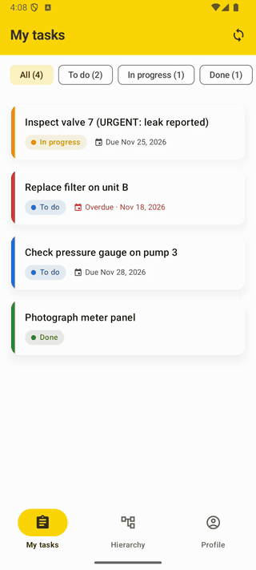

# EdgeAware Mobile (operators)

Kotlin Multiplatform app for field operators, for Android and iOS. The UI is shared
Compose Multiplatform code. Operators see their tasks, update their status, and keep
working offline; changes sync when the phone is back online.

Stack: Compose Multiplatform, Ktor (HTTP), SQLDelight (local SQLite), kotlinx.serialization.

<p align="center">
  
</p>

## What it does

- **Log in** with an EdgeAware account. "Server settings" on the login screen changes the
  backend address.
- **My tasks**: sorted (in progress, then to do, then done; soonest due first), filter
  chips with counts, overdue dates in red, and pull to refresh.
- **Task detail**: change status with one tap.
- **Offline first**: every change is saved on the phone immediately and queued; a cloud
  icon on the task card shows it hasn't synced yet. The Profile tab shows how many changes
  are waiting and when you last synced.
- **Sync toasts**: a sync you start (sync button, pull to refresh, a status change) shows
  "Synced" or "Server error". Background syncs only show a toast when they start failing.
- **Sync**: runs at startup, every 30 seconds, after each change, and on pull to refresh.
  It pushes queued changes, then pulls the server's change feed.
  - If a supervisor edited the same task meanwhile, the status change is retried on top of
    their version, so both edits are kept.
  - If the change is no longer allowed (e.g. the task was reassigned), it is dropped and
    the user sees a message.
  - Tasks deleted or reassigned on the server disappear from the phone.
  - After a long time offline (cursor expired), the app downloads a fresh snapshot.
- **Session expiry**: the app returns to login and keeps queued changes; they are sent
  after logging in again. Logging in as a different user clears the previous user's data.

## Project layout

```
composeApp/src/
  commonMain/     shared code: data/ (API, local store, sync), ui/ (screens), App.kt
  commonMain/sqldelight/   local database schema and queries
  androidMain/    Android entry point and platform glue
  iosMain/        iOS entry point (MainViewController) and platform glue
  androidUnitTest/ sync engine tests (fake server + in-memory SQLite)
iosApp/iosApp/    SwiftUI host files for the iOS app
```

## Run on Android

1. Start the backend from the repo root (see the main README). The Android emulator
   reaches your Mac at `10.0.2.2`, which is the app's default server address.
2. Open `mobile/` in Android Studio and run `composeApp`, or from the command line:

```bash
./gradlew :composeApp:installDebug
```

Log in with one of the seeded operators, e.g. `operator_n1a` (password in
`internal/seed/seed.go`).

## Tests

```bash
./gradlew :composeApp:testDebugUnitTest
```

## iOS: not built yet

The shared code already includes the iOS side (`iosMain`, `MainViewController`, and the
SwiftUI host files), but **iOS has not been built or run**: this needs Xcode, which was not
installed on the development machine. To finish it:

1. Install Xcode from the App Store, then run
   `sudo xcode-select -s /Applications/Xcode.app/Contents/Developer`.
2. In Xcode, create an iOS App project named `iosApp` inside `mobile/iosApp/` and add the two
   existing Swift files in `iosApp/iosApp/` (replacing the generated ones).
3. Add a **Run Script** build phase before "Compile Sources":
   `cd "$SRCROOT/.." && ./gradlew :composeApp:embedAndSignAppleFrameworkForXcode`
4. Build settings: add `$(SRCROOT)/../composeApp/build/xcode-frameworks/$(CONFIGURATION)/$(SDK_NAME)`
   to **Framework Search Paths**, and `-framework ComposeApp -lsqlite3` to
   **Other Linker Flags**. Turn **User Script Sandboxing** off.
5. Run on an iPhone simulator. It reaches the backend at `localhost:8080`.

## Before production

- Store the login token in the Android Keystore / iOS Keychain (currently app preferences).
- Use HTTPS. Plain HTTP is allowed only to `10.0.2.2` and `localhost` for development.
- Add refresh tokens on the backend: tokens expire after 15 minutes, which sends offline
  operators back to the login screen when they reconnect.
